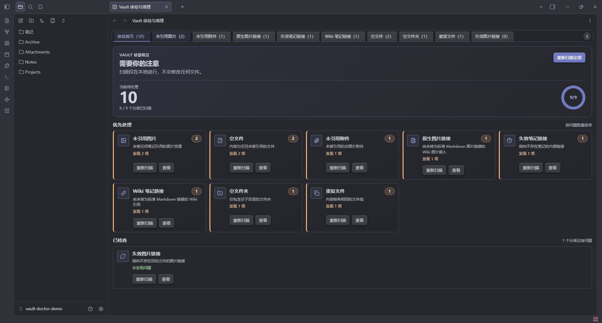
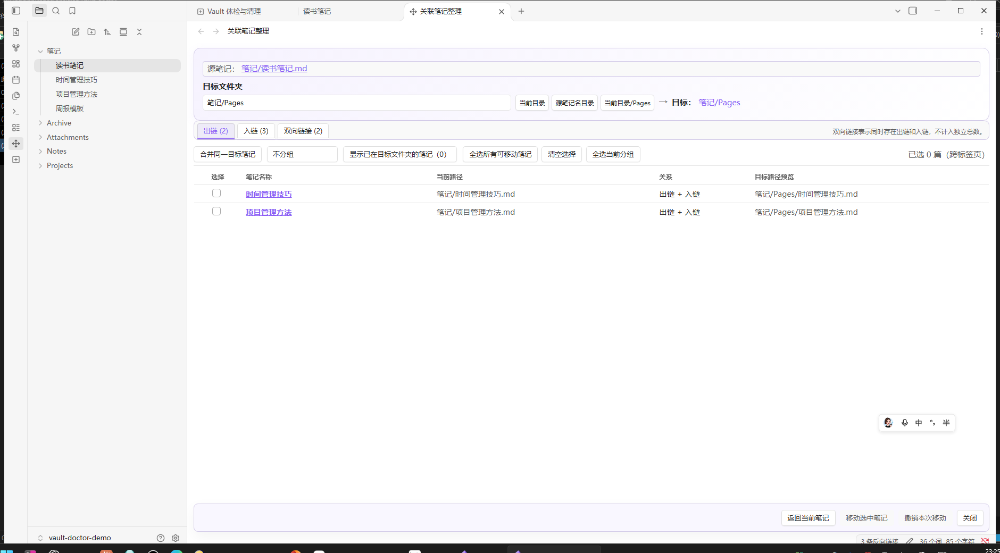
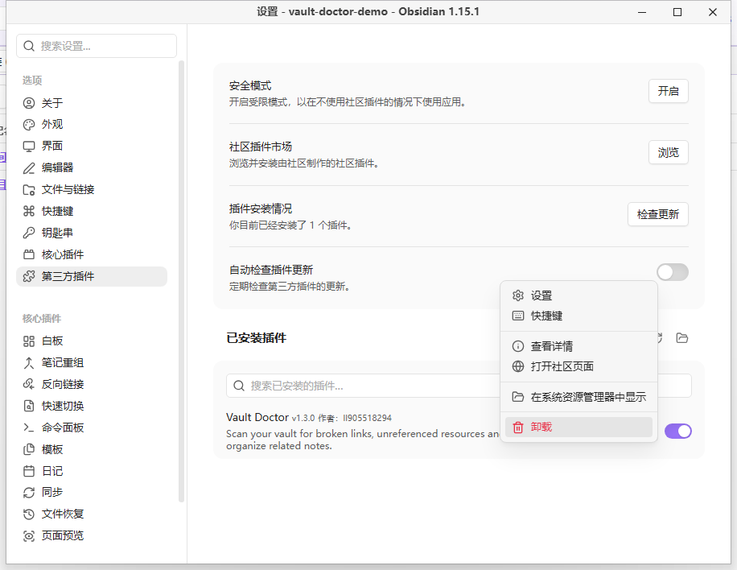

# Vault Doctor

**Vault Doctor** is an Obsidian plugin that scans your vault for broken links, unreferenced resources and duplicate files — then helps you fix them safely, not just list them. It runs fully offline and only changes files after you confirm.

- Unused images and attachments, empty files/folders, byte-identical duplicates, broken image and note links.
- Related-note organizer by outgoing, incoming and bidirectional links, with folder batch moves.
- Repo: <https://github.com/ll905518294/obsidian-vault-doctor> · Releases: <https://github.com/ll905518294/obsidian-vault-doctor/releases>

一个为 Obsidian 做的「Vault 体检 + 问题处理」插件：一次性扫描失效链接、未引用资源、重复文件等健康问题，并安全地完成整理，而不是只列清单。

- 仓库：<https://github.com/ll905518294/obsidian-vault-doctor>
- 发布：<https://github.com/ll905518294/obsidian-vault-doctor/releases>
- 系统要求：Obsidian 1.13.0 及以上，桌面端与移动端均可使用
- 许可证：0-BSD


> 截图取自演示库 `vault-doctor-demo`，仅含示例内容。

## 功能总览

| 模块 | 能做什么 |
| --- | --- |
| Vault 体检 | 一键扫描未引用图片、未引用附件、空文件、空文件夹、失效图片链接、失效笔记链接、原生图片链接、Wiki 笔记链接、重复文件 |
| 清理处理 | 勾选后通过删除按钮两段式确认移入 Obsidian 回收站；失效链接可移除；缺失笔记可创建；`![[图片]]` 可转换为标准 Markdown 语法 |
| 关联笔记整理 | 找出当前笔记的出链、入链、双向链接笔记，批量移动到指定文件夹 |
| 扫描报告 | 支持复制到剪贴板或导出 Markdown 报告，只包含路径与链接信息，不含笔记正文 |

## 快速上手

三步用起来：

1. **安装并启用**：按下方[安装说明](#安装与卸载)放好文件，在 **设置 → 第三方插件** 中启用 **Vault Doctor**。
2. **打开体检**：点击左侧栏的 <kbd>+</kbd> 方框图标，或运行命令「打开 vault 体检与清理」。
3. **扫描并处理**：点击右上角**开始扫描**，在体检首页按问题数量优先处理；进入分类标签页勾选条目后执行清理。**扫描不会修改任何文件，只有你确认的操作才会执行。**

**查看更新说明**：安装或升级到新版本后，首次打开会自动弹出一次该版本的中文更新说明（按新功能、改进、修复分类，含「开始使用」按钮）；同一版本不会重复弹出。之后可随时在命令面板搜索「查看更新说明」再次打开。

## Vault 体检与清理

点击左侧栏的**打开 vault 体检与清理**图标，或运行同名命令打开体检工具。桌面端以工作区标签页打开，移动端回退为弹窗。点击**开始扫描**后，**体检首页**与各分类标签页并列展示，可随时切回总览。

扫描默认不勾选任何条目；确认无误后自行勾选并执行清理。

### 体检首页

首页把所有检查项汇总成一张总览：顶部是**当前待处理**总数和扫描进度（`9/9 分类已扫描`），下方按**优先处理**（按问题数量排序）与**已检查（未发现问题）**分区。每个卡片都能直接**重新扫描**或**查看**明细，不必逐个标签页翻找。



### 检查项说明

- **未引用图片**：按设置中的可清理图片格式（默认 PNG、JPG/JPEG、GIF、WEBP、SVG、BMP、AVIF、ICO）扫描未被 Markdown 链接或 Canvas 文件节点引用的图片。采用保守策略：正文中以任何形式提到图片文件名或路径（HTML 标签、frontmatter 纯文本、代码块）都视为已引用，避免误报。
- **未引用附件**：扫描隐藏目录与忽略目录之外的所有非 Markdown、非 Canvas 文件，被链接、Canvas 节点或文字提及的文件会被排除。
- **空文件**：包括零字节的非图片、非 Canvas 文件，以及只含 YAML frontmatter 的 Markdown 文件。
- **空文件夹**：包括只包含空子文件夹的父级文件夹。`.obsidian`、`.trash`、`.git` 等隐藏目录永远不会被扫描。
- **失效图片链接**：本地目标无法解析的图片嵌入与图片链接单独成表，可勾选移除完整链接语法。外部 URL、HTML 图片、frontmatter 与代码块不参与扫描。
- **失效笔记链接**：指向不存在 Markdown 笔记的 Wiki 链接与 Markdown 链接单独成表，支持定位、本次忽略、移除或创建缺失目标；缺失的父文件夹会自动创建，已存在的文件与无效目标会跳过并报告。
- **原生图片链接**：全库查找 `![[图片.png]]` 形式的嵌入，可转换为 `` 标准语法。尺寸标注、未解析目标、代码块与 frontmatter 一律跳过；按笔记分组执行，可用 Obsidian 编辑历史撤销。
- **Wiki 笔记链接**：查找 `[[笔记]]`、`[[笔记|别名]]`、`[[笔记#标题]]`、`[[笔记^块id]]` 等指向 Markdown 笔记的 Wiki 链接，可转换为 `[显示文本](<路径.md>)` 标准尖括号 Markdown 链接；别名保留，标题与块引用转为 `#标题` / `#^块id` 锚点。图片等嵌入语法、外部 URL、非 Markdown 目标、无法解析的目标、代码块与 frontmatter 一律跳过；按笔记分组执行，可用 Obsidian 编辑历史撤销。操作：进入 **Wiki 笔记链接** 页签，勾选要转换的链接（无法解析或无需转换的会自动置灰），点击 **转换选中链接**，在弹出确认框点 **确认转换**；完成后底部状态栏更新，并弹出 `已转换：N，跳过：M，失败：K` 的提示。
- **重复文件**：先按文件大小预筛，再按 SHA-256 内容哈希精确分组，只把字节级相同的文件视为重复（不含相似内容）。删除选中的重复文件前会同步移除笔记中的对应链接；笔记编辑失败则阻止删除，避免产生新失效链接。

### 分类明细界面

**未引用图片**以缩略图卡片展示，可勾选、预览或删除；顶部可按分组（文件夹路径 / 扩展名）整理，底部显示已选数量，右侧为**移入回收站**。


**失效笔记链接**以表格展示源笔记、失效链接原文、未解析目标与链接类型；每行可**定位**或本次**忽略**，底部可**创建选中笔记**或**移除选中链接**。


**空文件**与**空文件夹**列表会标注文件大小，勾选后统一移入回收站。


**重复文件**按内容哈希分组，逐行列出每个副本被哪些笔记引用、位于哪个文件夹、当前状态（已引用 / 未发现引用），便于判断该保留哪一份。


### 安全设计

- 清理按你在 Obsidian 设置中选择的回收站选项移入 `.trash/` 或系统回收站，不直接删除文件；失效链接移除、原生图片链接与 Wiki 笔记链接转换直接编辑 Markdown，可用编辑历史撤销。
- **删除按钮两段式确认**：第一次点击「移入回收站 / 删除选中文件 / 删除」只会把按钮变为「确认删除」警示状态并提示「再次点击确认删除」；第二次点击才执行。3 秒无操作、焦点移出按钮或勾选变化都会自动复位，不再弹出二次确认弹窗。失效链接移除、缺失笔记创建、原生链接与 Wiki 链接转换和关联笔记移动仍使用各自的确认弹窗。误触说明：第一次点击只是**武装**按钮，不会删除任何文件；若误点了，不做任何操作等 3 秒即自动复位，或点击其它按钮 / 取消勾选也能立即复位。
- 重复文件支持整组全选删除：执行前会按内容哈希逐文件复核（引用清理失败、内容已变化或读取失败的单个文件会被跳过并说明原因），不会因为「每组必须保留一个副本」而拒绝整组操作。
- 执行清理前会对每个条目**重新复核**引用状态：扫描后被引用、被修改或已被移除的资源自动跳过。
- 图片清理后如需清理因此变空的文件夹，请先**重新扫描**再操作。
- Vault 内容发生变化后，旧扫描结果会标记**结果待复核，请重新扫描**，未扫描的分类显示**尚未扫描**。

## 关联笔记整理

从命令面板、左侧栏图标或 Markdown 文件右键菜单打开，支持多选笔记与整个文件夹批量处理；安装 Notebook Navigator 后可接入其多选与文件夹菜单。



- 关联笔记按**出链**、**入链**、**双向链接**三个标签页分组并显示数量；双向链接是出链与入链的交集，不重复计数。
- 跨标签页选择、当前分组全选、全库可移动笔记全选均支持；同一笔记被多个来源引用时只在移动列表中去重出现一次。
- 目标文件夹默认为来源笔记父文件夹加 `Pages`，也可手动输入完整路径，或使用快捷选项（当前文件夹、来源笔记文件夹、当前文件夹加 `Pages`）。
- 移动前有确认步骤；使用 Obsidian 原生文件管理器，链接更新遵循你自己的 Obsidian 设置；目标已存在的文件一律跳过，不覆盖、不自动改名；批量中的失败会单独报告，不回滚已成功的移动。

## 设置说明

在 **设置 → Vault Doctor** 中配置：


| 设置项 | 含义 |
| --- | --- |
| 默认分组方式 | 打开关联笔记整理时列表的分组方式：不分组、按源笔记分组（默认）或按当前路径分组；面板内可临时切换 |
| 默认隐藏已在目标文件夹的笔记 | 已经位于最终目标文件夹的关联笔记默认不显示，减少干扰 |
| 可清理图片格式 | 参与未引用图片扫描的扩展名，默认 PNG、JPG/JPEG、GIF、WEBP、SVG、BMP、AVIF、ICO；可用逗号、空格或中文逗号分隔 |
| 忽略目录 | 这些目录及其子目录不参与未引用图片、未引用附件与空文件夹扫描；失效链接与原生图片链接检查不受影响 |

> 早期版本的「关联数量属性」功能（`related-operations-in-links` 等三个 frontmatter 属性）已移除。插件不再读写这些属性；笔记中遗留的属性不受影响，相关功能均为按需实时计算。

## 隐私与本地运行

- 插件**不发起任何网络请求**，没有遥测、云同步或第三方服务依赖；所有扫描与处理都在本地 Vault 内完成。
- 扫描阶段只读取文件与元数据，不写入、不改名、不移动文件；只有你在界面中确认的操作才会执行。
- 插件只访问当前 Vault 内的文件；桌面端的「在系统资源管理器中显示」只是让文件管理器定位该文件，不读取 Vault 之外的路径。
- 插件自身设置保存在 `.obsidian/plugins/vault-doctor/data.json`，不含笔记正文。

## 安装与卸载

插件尚未上架 Obsidian 社区市场（提交通过 <https://community.obsidian.md/> 网页完成，需 Obsidian 账号并绑定 GitHub），上架前可手动安装：

1. 从 [Releases](https://github.com/ll905518294/obsidian-vault-doctor/releases) 下载最新版 `main.js`、`manifest.json`、`styles.css`。
2. 将三个文件放入 `<Vault>/.obsidian/plugins/vault-doctor/`。
3. 在 **设置 → 第三方插件** 中启用 **Vault Doctor**。

启用后在 **设置 → 第三方插件 → 已安装插件** 可以看到它；点右侧 **⋯ → 设置** 打开配置页，**⋯ → 在系统资源管理器中显示** 可直接定位安装目录。



卸载：在 **设置 → 第三方插件** 禁用 **Vault Doctor**，然后删除 `<Vault>/.obsidian/plugins/vault-doctor/` 文件夹。这会删除插件自身的 `data.json` 设置；不影响笔记内容，也不会恢复已进入回收站的文件。

## 开发与验证

```bash
npm install       # 安装依赖（Node.js 22+）
npm run dev       # 开发构建（watch）
npm run build     # 生产构建（tsc 检查 + esbuild 打包）
npm run lint      # ESLint 检查
npm test          # Node 原生测试
npm run deploy    # 构建并部署到当前打开的 Vault（见下）
```

测试使用 Node.js 22+ 的原生 TypeScript 类型擦除；插件产物本身以 ES2021 为目标。`npm run build` 只生成项目根目录的构建产物，不会修改 Vault。

### 本地一键部署（Windows）

双击项目根目录的 `deploy-and-restart.cmd`，或运行 `npm run deploy`：脚本自动识别当前打开的唯一 Vault，构建并替换 `vault-doctor` 插件文件、校验哈希，然后重启 Obsidian 等待其稳定运行；旧版本会先备份到 `.obsidian/plugin-backups/`。没有唯一打开的 Vault、构建失败、校验失败或无法稳定重启时，脚本会停止且不继续部署。

`npm run deploy:check` 只构建并检查，不复制文件、不重启 Obsidian，用于部署前确认目标 Vault 与安装状态。

## 已知限制

- 重复检测只识别字节级相同的文件，不识别内容相似。
- 失效链接移除与原生图片链接、Wiki 笔记链接转换直接编辑 Markdown，依赖 Obsidian 编辑历史撤销，不经过回收站。
- `npm run deploy` 依赖 Windows PowerShell、Obsidian CLI 与恰好一个打开的 Vault。

## 风险分级与恢复

| 操作 | 确认方式 | 去向 | 如何恢复 |
| --- | --- | --- | --- |
| 未引用图片 / 附件 / 空文件 / 空文件夹 / 重复文件 | 删除按钮两段式确认 | 按你的设置进入 `.trash/` 或系统回收站 | Obsidian 回收站或系统回收站 |
| 失效图片链接 / 失效笔记链接移除、原生图片链接与 Wiki 笔记链接转换 | 确认弹窗 | 直接改写 Markdown | Obsidian 编辑历史撤销（不经过回收站） |
| 关联笔记移动 | 确认弹窗 | 移动到目标文件夹 | 手动移回原文件夹，链接随 Obsidian 设置更新 |

## 常见问题

**扫描会修改我的笔记吗？**
不会。扫描只读取文件与元数据；移入回收站、移除链接、转换链接、移动笔记等操作都需要你先勾选并确认。

**清理后发现选错了，能恢复吗？**
移入回收站的文件可在 Obsidian 回收站（`.trash/`）或系统回收站中恢复；失效链接移除与原生图片链接、Wiki 笔记链接转换直接改写 Markdown，可用 Obsidian 的编辑历史撤销。

**插件会联网或上传我的笔记吗？**
不会。插件没有任何网络请求，也不收集或上传 Vault 内容。

**支持移动端吗？**
支持。插件在移动端以弹窗形式提供体检与关联笔记功能；`npm run deploy` 一键部署脚本仅适用于 Windows 桌面。

**和 Notebook Navigator 是什么关系？**
Notebook Navigator 是可选集成：安装后可接入其多选与文件夹菜单，未安装时插件核心功能仍可正常使用。

## 许可证

[0-BSD](LICENSE)
