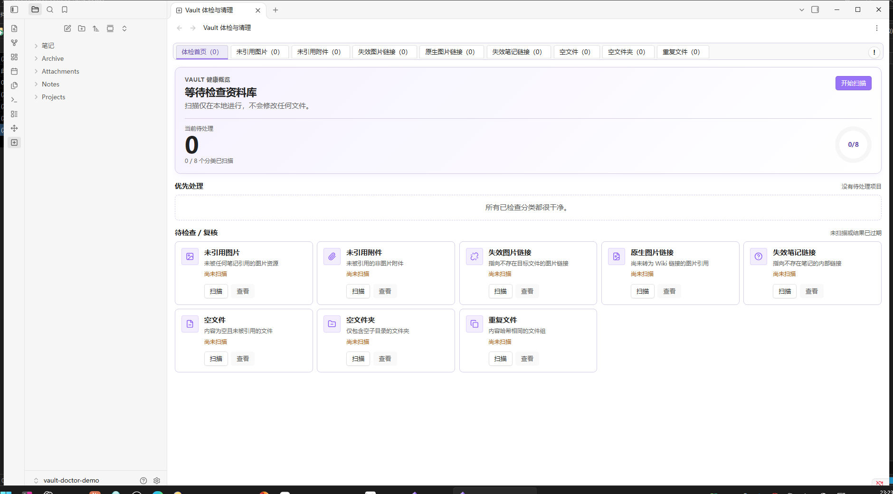
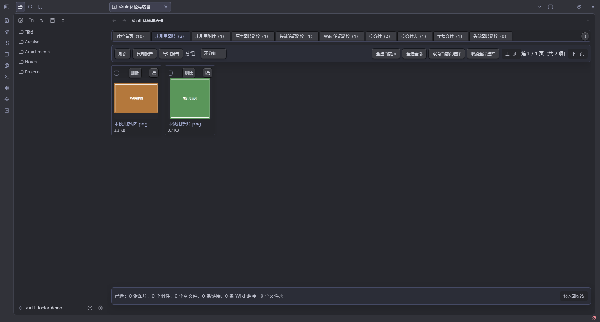
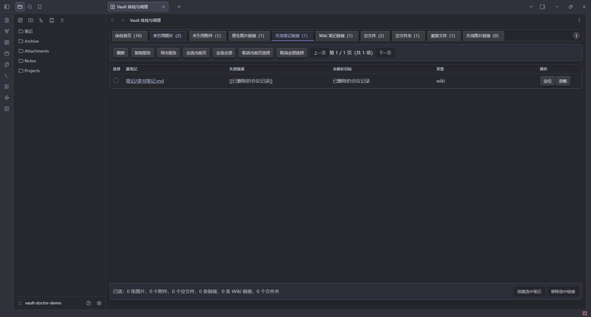
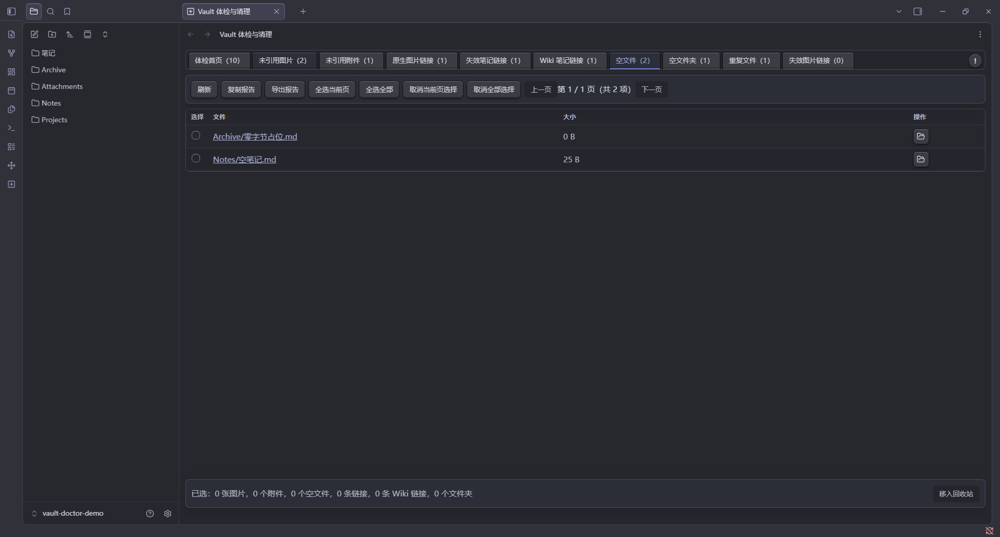
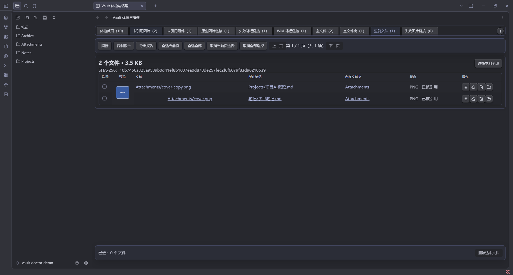
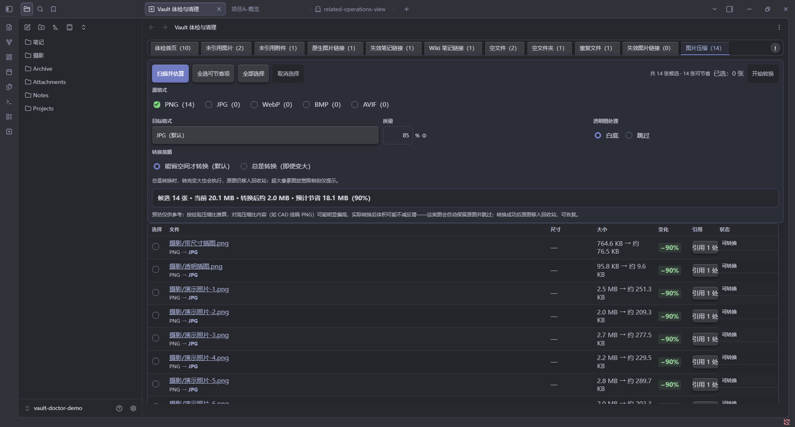
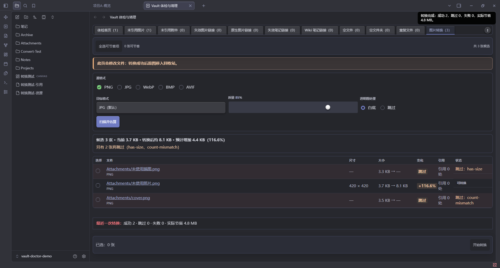
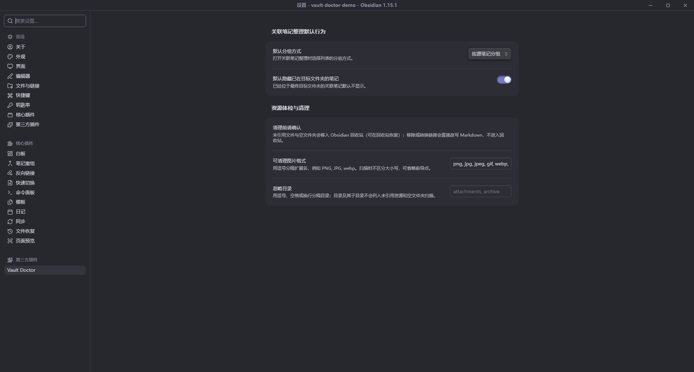

# Vault Doctor

**Vault Doctor** is an Obsidian plugin that scans a vault for nine kinds of health problems, converts images and organizes related notes — then helps you fix them safely, not just list them. It runs fully offline and only changes files after you confirm. Cleanup goes through Obsidian's trash, moves support undo, and image conversion rewrites references with a per-image safety check.

## What it does

Vault Doctor brings three tools into one workspace panel:

- **Vault health check** — scans 9 categories: unused images, unused attachments, empty files, empty folders, broken image links, broken note links, native image links, wiki note links and byte-identical duplicate files.
- **Image format conversion** — batch-convert PNG, JPG, WebP, BMP and AVIF to JPG, WebP or PNG. Before converting, it shows an **estimated** output size and savings based on source format, target format and quality; the real size is determined during conversion. Transparency, oversized images and reference rewritability are checked precisely at conversion time. References in Wiki embeds, Markdown links, HTML `img`, frontmatter and Canvas are rewritten safely, and the source image is moved to trash only after verification.
- **Related-note organizer** — find outgoing, incoming and bidirectional links for the current note, then batch-move notes to a target folder. The latest move can be undone.

Everything runs locally: no network requests and no telemetry. Scans never modify files; deletions require two-step confirmation and go through Obsidian's trash, while link edits rely on Obsidian's undo history.

## Feature highlights

- 9-category vault health scan with progress, abort and cached "last scan" results.
- Image conversion with a per-image transaction: revalidate, rewrite references, verify, then trash the source.
- Estimated size preview marked as approximate; quality scaling is applied for lossy targets and transparency is checked during conversion.
- Related-note moves with confirmation, skip-existing behavior and undo of the latest batch.
- Keyboard and screen-reader support, plus respect for reduced motion.
- Markdown scan reports that contain paths and links only, never note body text.

## Quick start

1. Download `main.js`, `manifest.json` and (if present) `styles.css` from the [latest release](https://github.com/ll905518294/obsidian-vault-doctor/releases).
2. Put the files in `<Vault>/.obsidian/plugins/vault-doctor/`.
3. Enable **Vault Doctor** in **Settings → Community plugins**.
4. Open the **Vault 体检与清理** panel from the ribbon icon or the command palette.

A ZIP with the same three files is also attached to each release. The ZIP is a convenience bundle, not a Windows installer.

## Requirements

- Obsidian **1.13.0** or newer.
- Desktop only (Windows, macOS, Linux); mobile is not supported.

## License

0-BSD.

Chinese documentation follows below. / 中文说明见下方。

一个为 Obsidian 做的「Vault 体检 + 问题处理」插件：一次性扫描 9 类健康问题（失效链接、未引用资源、重复文件等），并提供图片格式转换优化工具，安全地完成整理，而不是只列清单。

- 仓库：<https://github.com/ll905518294/obsidian-vault-doctor>
- 发布：<https://github.com/ll905518294/obsidian-vault-doctor/releases>
- 系统要求：Obsidian 1.13.0 及以上，仅支持桌面端（Windows / macOS / Linux）
- 许可证：0-BSD



> 截图取自演示库 `vault-doctor-demo`，仅含示例内容。
>
> 截图为 1.8.0 界面；「图片转换」页签见[图片格式转换](#图片格式转换)。

## 功能总览

| 模块 | 能做什么 |
| --- | --- |
| Vault 体检 | 一键扫描未引用图片、未引用附件、空文件、空文件夹、失效图片链接、失效笔记链接、原生图片链接、Wiki 笔记链接、重复文件；扫描可随时中止，已完成的分类结果保留；结果缓存在插件设置里，重开面板显示「上次扫描」时间，设置变化时自动失效 |
| 清理处理 | 勾选后通过删除按钮两段式确认移入 Obsidian 回收站；失效链接可移除；缺失笔记可创建；`![[图片]]` 可转换为标准 Markdown 语法 |
| 图片转换 | 首页与标签条末尾都有入口：进入页签先轻量枚举候选，点「扫描并估算」按格式与质量快速预估空间并显示进度（不逐张解码）；批量把 PNG/JPG/WebP/BMP/AVIF 转为 JPG/WebP/PNG，安全改写引用，估算与转换都可以中止 |
| 关联笔记整理 | 找出当前笔记的出链、入链、双向链接笔记，批量移动到指定文件夹 |
| 扫描报告 | 支持复制到剪贴板或导出 Markdown 报告，只包含路径与链接信息，不含笔记正文 |
| 性能 | 全部在本地完成：图片转换估算改为纯数学预估，只读文件体积与 Obsidian 引用索引，本机 5615 张约 5.4 秒（不再逐张解码）；重复文件在大小预筛后最多 8 路并发计算 SHA-256（按文件体积预算自动下调，约 8 倍），正文引用匹配只比对文件名尾段 |
| 键盘与读屏 | 同组图片预览只占一个 Tab 停靠点，方向键切换、Enter 或空格打开；弹窗关闭后焦点回到触发元素，并声明 `role="dialog"` 与可访问名称；表头带 `scope="col"`；跟随系统「减少动态效果」 |

## 快速上手

三步用起来：

1. **安装并启用**：按下方[安装说明](#安装与卸载)放好文件，在 **设置 → 第三方插件** 中启用 **Vault Doctor**。
2. **打开体检**：点击左侧栏的 <kbd>+</kbd> 方框图标，或运行命令「打开 vault 体检与清理」。
3. **扫描并处理**：点击右上角**开始扫描**，在体检首页按问题数量优先处理；进入分类标签页勾选条目后执行清理。**扫描不会修改任何文件，只有你确认的操作才会执行。**

**首次使用引导**：第一次安装并加载插件时会自动弹出三步引导（它能做什么、安全说明、怎么开始，含界面截图），点「开始使用」可直接打开体检面板。之后可在命令面板搜索「打开使用引导」重看；设置里的「首次显示使用引导」关闭后不再自动弹出。

**查看更新说明**：安装或升级到新版本后，首次打开会自动弹出一次该版本的中文更新说明（按新功能、改进、修复分类，含「开始使用」按钮）；同一版本不会重复弹出。之后可随时在命令面板搜索「查看更新说明」再次打开。

## Vault 体检与清理

点击左侧栏的**打开 vault 体检与清理**图标，或运行同名命令打开体检工具。工具以工作区标签页打开。点击**开始扫描**后，**体检首页**与各分类标签页并列展示，可随时切回总览。

扫描默认不勾选任何条目；确认无误后自行勾选并执行清理。

### 体检首页

首页把所有检查项汇总成一张总览：顶部是**当前待处理**总数和扫描进度（`9/9 分类已扫描`），下方按**优先处理**（按问题数量排序）与**已检查（未发现问题）**分区。每个卡片都能直接**重新扫描**或**查看**明细，不必逐个标签页翻找。扫描期间标题栏会出现**中止扫描**，点它会在当前分类结束后停下，已完成的分类结果全部保留，首页标注「扫描已中止」。

扫描结果会缓存在插件设置中：重新打开面板直接显示上次结果，并标注「上次扫描：日期 时间」，点**重新扫描全部**才会更新；修改图片格式或忽略目录后，旧缓存自动失效。

首页同时提供**图片转换**卡片：它不属于 9 类扫描，**开始扫描**只更新 9 类结果，不会为转换候选解码或估算体积；卡片显示「尚未估算 / 正在估算 / N 张图片可转换」等状态，有可转换图片时计入顶部「当前待处理」总数，点卡片或**查看**即可进入图片转换页签。


### 检查项说明

- **未引用图片**：按设置中的可清理图片格式（默认 PNG、JPG/JPEG、GIF、WEBP、SVG、BMP、AVIF、ICO）扫描未被 Markdown 链接或 Canvas 文件节点引用的图片。采用保守策略：正文中以任何形式提到图片文件名或路径（HTML 标签、frontmatter 纯文本、代码块）都视为已引用，避免误报。
- **未引用附件**：扫描隐藏目录与忽略目录之外、不属于可清理图片格式的非 Markdown、非 Canvas 文件；被链接、Canvas 节点或文字提及的文件会被排除。若把某种扩展名从「可清理图片格式」里去掉，这类文件会改按附件参与扫描。
- **空文件**：包括零字节的非图片、非 Canvas 文件，以及只含 YAML frontmatter 的 Markdown 文件。
- **空文件夹**：包括只包含空子文件夹的父级文件夹。`.obsidian`、`.trash`、`.git` 等隐藏目录永远不会被扫描。
- **失效图片链接**：本地目标无法解析的图片嵌入与图片链接单独成表，可勾选移除完整链接语法。外部 URL、HTML 图片、frontmatter 与代码块不参与扫描。
- **失效笔记链接**：指向不存在 Markdown 笔记的 Wiki 链接与 Markdown 链接单独成表，支持定位、本次忽略、移除或创建缺失目标；缺失的父文件夹会自动创建，已存在的文件与无效目标会跳过并报告。
- **原生图片链接**：全库查找 `![[图片.png]]` 形式的嵌入，可转换为 `` 标准语法。尺寸标注、未解析目标、代码块与 frontmatter 一律跳过；按笔记分组执行，可用 Obsidian 编辑历史撤销。
- **Wiki 笔记链接**：查找 `[[笔记]]`、`[[笔记|别名]]`、`[[笔记#标题]]`、`[[笔记^块id]]` 等指向 Markdown 笔记的 Wiki 链接，可转换为 `[显示文本](<路径.md>)` 标准尖括号 Markdown 链接；别名保留，标题与块引用转为 `#标题` / `#^块id` 锚点。图片等嵌入语法、外部 URL、非 Markdown 目标、无法解析的目标、代码块与 frontmatter 一律跳过；按笔记分组执行，可用 Obsidian 编辑历史撤销。操作：进入 **Wiki 笔记链接** 页签，勾选要转换的链接（无法解析或无需转换的会自动置灰），点击 **转换选中链接**，在弹出确认框点 **确认转换**；完成后底部状态栏更新，并弹出 `已转换：N，跳过：M，失败：K` 的提示。
- **重复文件**：先按文件大小预筛，再按 SHA-256 内容哈希精确分组，只把字节级相同的文件视为重复（不含相似内容）。删除选中的重复文件前会同步移除笔记中的对应链接；笔记编辑失败则阻止删除，避免产生新失效链接。

### 分类明细界面

**未引用图片**以缩略图卡片展示，可勾选、预览或删除；顶部可按**按路径**或**按格式**分组（也可不分组），底部显示已选数量，右侧为**移入回收站**。



**失效笔记链接**以表格展示源笔记、失效链接原文、未解析目标与链接类型；每行可**定位**或本次**忽略**，底部可**创建选中笔记**或**移除选中链接**。



**空文件**与**空文件夹**列表会标注文件大小，勾选后统一移入回收站。



**重复文件**按内容哈希分组，逐行列出每个副本被哪些笔记引用、位于哪个文件夹、当前状态（已引用 / 未发现引用），便于判断该保留哪一份。



### 安全设计

- 清理按你在 Obsidian 设置中选择的回收站选项移入 `.trash/` 或系统回收站，不直接删除文件；失效链接移除、原生图片链接与 Wiki 笔记链接转换直接编辑 Markdown，可用编辑历史撤销。
- **删除按钮两段式确认**：第一次点击「移入回收站 / 删除选中文件 / 删除」只会把按钮变为「确认删除」警示状态并提示「再次点击确认删除」；第二次点击才执行。3 秒无操作、焦点移出按钮或勾选变化都会自动复位，不再弹出二次确认弹窗。失效链接移除、缺失笔记创建、原生链接与 Wiki 链接转换和关联笔记移动仍使用各自的确认弹窗。误触说明：第一次点击只是**武装**按钮，不会删除任何文件；若误点了，不做任何操作等 3 秒即自动复位，或点击其它按钮 / 取消勾选也能立即复位。
- 重复文件支持整组全选删除：执行前会按内容哈希逐文件复核（引用清理失败、内容已变化或读取失败的单个文件会被跳过并说明原因），不会因为「每组必须保留一个副本」而拒绝整组操作。
- 执行清理前会对每个条目**重新复核**引用状态：扫描后被引用、被修改或已被移除的资源自动跳过。
- 图片清理后如需清理因此变空的文件夹，请先**重新扫描**再操作。
- Vault 内容发生变化后，旧扫描结果会标记**结果待复核，请重新扫描**，未扫描的分类显示**尚未扫描**。

## 图片格式转换

「图片转换」是体检与清理面板标签条末尾的独立标签页，用于在保持图片可用的前提下缩小体积。它不属于 9 类体检问题，也不计入健康度或 6 阶段扫描；首页会单独显示一张**图片转换**卡片，有可转换图片时计入顶部「当前待处理」总数。打开 **体检与清理** 后切换到 **图片转换**，或直接点首页卡片即可使用。



首次进入页签时会先做一次轻量枚举：只按源格式、忽略目录与目标格式筛出候选，不读文件、不估算体积；之后切换源格式或目标格式也会重新枚举。点**扫描并估算**后按源格式、目标格式与质量推算每张图的预估体积，同时显示「正在估算 x / y · 当前文件」与进度条；估算不读取图片内容，也不解码。完成后列表列出每张候选图的当前大小、转换后**约**多大与变化幅度；尺寸列在快速预估下显示 `—`，引用处数按 Obsidian 引用索引统计。汇总条只累计可转换项，会跳过的图片单独计数并写明原因。选好条目后点**开始转换**（需连点两次确认），转换期间逐张真实解码与编码并显示同样的进度信息，结束后底部状态栏与右上角提示会给出成功、跳过、失败数量与实际节省的空间。



### 可选项

| 选项 | 可选值 | 默认 |
| --- | --- | --- |
| 源格式 | PNG、JPG、WebP、BMP、AVIF（可多选） | 只勾选 PNG |
| 目标格式 | JPG、WebP、PNG | JPG |
| 质量 | 50–95 | 85 |
| 透明图处理 | 白底、跳过 | 白底 |

目标格式为 PNG 时质量滑块不可用：PNG 为无损编码，质量参数不生效。超过 4000 万像素的图片会在转换阶段跳过（快速预估不解码，因此估算列表不再预标记）。

设置页可预先配置**目标格式**、**默认质量**与**透明图处理**；在页面内调整这三项时会同步保存为下一次的默认值。源格式只在页面内勾选，默认勾选 PNG。

只处理上述源格式。GIF（转换会丢失动画）、SVG、TIFF、HEIC/HEIF、ICO 不处理；`.obsidian`、隐藏目录和设置中的「忽略目录」会被排除。

### 透明图

- **估算不检测透明**：快速预估不解码，因此估算列表不显示「透明」标记；是否含透明通道在转换时按实际像素判断。
- **白底**：把透明区域铺成白色再编码，适合 JPG 等不支持透明的目标。
- **跳过**：选「跳过」时，含透明通道的图片在转换时一律跳过，与目标格式无关；JPG 目标下同样先跳过。估算阶段不会因此提前阻断，转为在转换时精确判定。
- **JPG 始终铺白底**：目标为 JPG 时编码强制把透明区域铺成白色（JPG 不支持透明通道）；这条只作用于真正被转换的图片，选「跳过」的透明图不会走到编码这一步。

### 会跳过的情况

估算阶段只会提前标出**目标同名文件已存在**与**多张图片会转换为同一目标文件**；其余风险在转换时逐张精确检查，跳过的条目会在结果里写明原因：

- Wiki 嵌入带尺寸参数，如 `![[cover.png|120]]`，整张跳过。
- frontmatter 里的裸路径；可解析的 Wiki 链接仍可改写。
- `<picture><source>`、`srcset`、CSS `url()`。
- 代码块内的引用，包括 Excalidraw 代码块。
- 引用计数与 Obsidian 缓存不一致；需重新扫描后再试。
- 选择「跳过」时，含透明通道的图片（与目标格式无关）。
- 无扩展名引用存在同名文件、超过 4000 万像素，或解码/编码失败。

### 空间预估

候选列表显示**候选数**、**当前体积**、**转换后约多少**与**预计节省**。汇总条只累计可转换项，估算阶段已能确定的跳过项单独显示数量。

预估是**经验值**：按「源格式 → 目标格式」的经验压缩比乘以当前文件体积，再按质量线性缩放（PNG 为无损目标，质量不参与）。它只用于判断量级与挑选候选项，**不会逐张解码或重编码**，因此 5000+ 张也能在秒级完成；最终体积以转换时的真实编码结果为准。

如果预估转换后反而更大，汇总显示**预计增加**，单行显示 `+x%`；这类图片可以不勾选。

### 耗时与中止

- 估算只遍历文件列表与内存中的引用索引，不解码、不读图片，耗时基本只随候选数量线性增长；转换仍按 **1 个并发**逐张串行，真实解码、编码、改写引用，并各自处理大图与透明图。
- 估算与转换期间都会显示「正在估算 / 转换 x / y · 当前文件」和进度条；大批量图片时进度文字最多约每 150 ms 刷新一次，避免界面卡顿。
- 估算与转换都支持中止；中止在文件之间生效，已完成部分保留。转换单张大图编码时界面可能短暂停顿。

### 安全执行

每张图独立执行一次事务：

1. 重新校验文件仍存在、仍在候选范围内，并记录大小与 mtime。
2. 校验引用位置可定位，避免改写错位置。
3. 生成目标格式的新文件。
4. 改写引用并自校验。
5. 删除前再次核对源图大小与 mtime，并独立扫描所有 Markdown/Canvas 原文；残留旧路径或源图被改动就回滚，不删原图。
6. 校验通过后，把原图移入 Obsidian 回收站。

读取后与删除前都会复核源图；同步盘或其它程序改动源图时放弃删除并回滚。引用改写覆盖：

- Wiki 嵌入，保留别名；含尺寸参数的嵌入会跳过。
- 标准 Markdown 图片链接，兼容尖括号目标、标题与 URL 编码。
- HTML ``；`<picture><source>`、`srcset` 会跳过。
- frontmatter 中的 Wiki 链接；裸路径会跳过。
- Canvas 节点的 `file` 字段；Canvas 文本节点里的引用会跳过。

转换会修改文件内容与文件本身，和首页「扫描只读」不同；预估为经验值，请确认量级后再执行，实际大小以转换结果为准。整个过程在本地完成，不引入依赖、不发起网络请求。

### 失败与恢复

- 改写引用失败：尝试恢复原文并删除本次新建文件，原图保留。
- 回滚时发现笔记被用户改过：保留用户内容，不覆盖，只把该笔记列为「未能回滚」，并保留新文件。
- 回滚失败（笔记恢复失败或新文件删除失败）：保留新文件，避免出现指向已删除文件的链接。
- 引用已改好但原图移入回收站失败：保留新文件与现状，原图也保留；再次执行只重试移入回收站，不重新编码。
- 恢复原图：按 Obsidian 回收站设置从 `.trash/` 或系统回收站还原；引用仍指向新文件，完全回退需手动改回并删除新文件。

### 已知限制

- 转换会丢弃 EXIF/GPS/ICC 与色彩配置文件。
- 照片方向由浏览器自动扶正，不额外写入方向信息。
- 不缩放、不裁剪，只改变编码格式与质量。
- 原图恢复依赖 Obsidian 回收站；清空回收站后无法从插件内恢复。
- 不处理 GIF、SVG、TIFF、HEIC/HEIF、ICO。

## 关联笔记整理

从命令面板、左侧栏图标或 Markdown 文件右键菜单打开，支持多选笔记与整个文件夹批量处理；安装 Notebook Navigator 后可接入其多选与文件夹菜单。


- 关联笔记按**出链**、**入链**、**双向链接**三个标签页分组并显示数量；双向链接是出链与入链的交集，不重复计数。
- 跨标签页选择、当前分组全选、全库可移动笔记全选均支持；同一笔记被多个来源引用时只在移动列表中去重出现一次。
- 目标文件夹默认为来源笔记父文件夹加 `Pages`，也可手动输入完整路径，或使用快捷选项（当前目录、源笔记名目录、当前目录/Pages）。
- 移动前有确认步骤；使用 Obsidian 原生文件管理器，链接更新遵循你自己的 Obsidian 设置；目标已存在的文件一律跳过，不覆盖、不自动改名；批量中的失败会单独报告，不回滚已成功的移动。
- 移动完成后可点 **撤销本次移动**（按钮显示本次移动数量）：按相反顺序把文件移回原路径；目标路径已被占用、文件已不存在或改名失败会跳过并报告，只对最近一次移动生效。

## 设置说明

在 **设置 → Vault Doctor** 中配置：



| 设置项 | 含义 |
| --- | --- |
| 默认分组方式 | 打开关联笔记整理时列表的分组方式：不分组、按源笔记分组（默认）或按当前路径分组；面板内可临时切换 |
| 默认隐藏已在目标文件夹的笔记 | 已经位于最终目标文件夹的关联笔记默认不显示，减少干扰 |
| 可清理图片格式 | 参与未引用图片扫描的扩展名，默认 PNG、JPG/JPEG、GIF、WEBP、SVG、BMP、AVIF、ICO；可用逗号、空格或中文逗号分隔 |
| 忽略目录 | 这些目录及其子目录不参与未引用图片、未引用附件与空文件夹扫描；失效链接与原生图片链接检查不受影响 |
| 首次显示使用引导 | 开启时，首次加载插件自动弹出一次三步引导；关闭后不再自动弹出，仍可通过命令「打开使用引导」重看 |
| 图片转换：目标格式 | 图片转换页的默认输出格式：JPG（默认）、WebP 或 PNG；在页面内调整会同步保存为新的默认值 |
| 图片转换：默认质量 | 默认 85，范围 50–95；越高体积越大、画质越好。目标为 PNG 时质量不生效 |
| 图片转换：透明图处理 | 含透明通道图片的默认处理方式：白底（默认）或跳过 |

> 早期版本的「关联数量属性」功能（`related-operations-in-links` 等三个 frontmatter 属性）已移除。插件不再读写这些属性；笔记中遗留的属性不受影响，相关功能均为按需实时计算。

## 隐私与本地运行

- 插件**不发起任何网络请求**，没有遥测、云同步或第三方服务依赖；所有扫描与处理都在本地 Vault 内完成。
- 扫描阶段只读取文件与元数据，不写入、不改名、不移动文件；只有你在界面中确认的操作才会执行。
- 插件只访问当前 Vault 内的文件；桌面端的「在系统资源管理器中显示」只是让文件管理器定位该文件，不读取 Vault 之外的路径。
- 插件自身设置保存在 `.obsidian/plugins/vault-doctor/data.json`，不含笔记正文。

## 安装与卸载

插件尚未上架 Obsidian 社区市场（提交通过 <https://community.obsidian.md/> 网页完成，需 Obsidian 账号并绑定 GitHub），上架前可手动安装。Obsidian 只认插件目录里的文件，所以两种方式都要把文件放进 `<Vault>/.obsidian/plugins/vault-doctor/`。

**方式 A：下载 ZIP（省事，推荐）**

1. 从 [Releases](https://github.com/ll905518294/obsidian-vault-doctor/releases) 下载 `vault-doctor-<版本号>.zip`。
2. 把 ZIP 里的内容**解压到** `<Vault>/.obsidian/plugins/vault-doctor/`（ZIP 内文件就在根层，不要先解出一层文件夹再套一层）。
3. 在 **设置 → 第三方插件** 中启用 **Vault Doctor**。

**方式 B：下载三件套（Obsidian 官方分发格式）**

1. 从 [Releases](https://github.com/ll905518294/obsidian-vault-doctor/releases) 下载最新版 `main.js`、`manifest.json`、`styles.css`。
2. 将三个文件放入 `<Vault>/.obsidian/plugins/vault-doctor/`。
3. 在 **设置 → 第三方插件** 中启用 **Vault Doctor**。

两种方式的文件完全相同：ZIP 只是把三件套打成一个包，方便下载和搬运，不是 Windows 安装程序，也不会自动写系统路径。社区目录按 Obsidian 的三件套格式审核，所以 Releases 会同时保留三件套与 ZIP。

启用后在 **设置 → 第三方插件 → 已安装插件** 可以看到它；点右侧 **⋯ → 设置** 打开配置页，**⋯ → 在系统资源管理器中显示** 可直接定位安装目录。


卸载：在 **设置 → 第三方插件** 禁用 **Vault Doctor**，然后删除 `<Vault>/.obsidian/plugins/vault-doctor/` 文件夹。这会删除插件自身的 `data.json` 设置；不影响笔记内容，也不会恢复已进入回收站的文件。

## 开发与验证

```bash
npm install       # 安装依赖（Node.js 22+）
npm run dev       # 开发构建（watch）
npm run build     # 生产构建（tsc 检查 + esbuild 打包）
npm run lint      # ESLint 检查
npm test          # Node 原生测试
npm run package   # 打包安装包：dist/vault-doctor-<版本号>.zip
npm run package:check  # 只校验打包输入，不写文件
npm run deploy    # 构建并部署到当前打开的 Vault（见下）
```

测试使用 Node.js 22+ 的原生 TypeScript 类型擦除；插件产物本身以 ES2021 为目标。`npm run build` 只生成项目根目录的构建产物，不会修改 Vault。

`npm run package` 读 `manifest.json` 的版本号，把 `main.js`、`manifest.json` 和可选的 `styles.css` 打成 `dist/vault-doctor-<版本号>.zip`（ZIP 内文件位于根层），并在写出后重新解压校验条目、大小、CRC-32 与包内版本号。它不依赖第三方压缩库，也不会自动构建——`main.js` 不存在时直接报错，先跑 `npm run build`。

### 本地一键部署（Windows）

双击项目根目录的 `deploy-and-restart.cmd`，或运行 `npm run deploy`：脚本自动识别当前打开的唯一 Vault，构建并替换 `vault-doctor` 插件文件、校验哈希，然后重启 Obsidian 等待其稳定运行；旧版本会先备份到 `.obsidian/plugin-backups/`。没有唯一打开的 Vault、构建失败、校验失败或无法稳定重启时，脚本会停止且不继续部署。

`npm run deploy:check` 只构建并检查，不复制文件、不重启 Obsidian，用于部署前确认目标 Vault 与安装状态。

## 已知限制

- 仅支持桌面端（移动端不可用）。
- 重复检测只识别字节级相同的文件，不识别内容相似。
- 图片转换会丢弃 EXIF/GPS/ICC 与色彩配置文件，不缩放、不裁剪；原图恢复依赖 Obsidian 回收站。
- 失效链接移除与原生图片链接、Wiki 笔记链接转换直接编辑 Markdown，依赖 Obsidian 编辑历史撤销，不经过回收站。
- `npm run deploy` 依赖 Windows PowerShell、Obsidian CLI 与恰好一个打开的 Vault。

## 风险分级与恢复

| 操作 | 确认方式 | 去向 | 如何恢复 |
| --- | --- | --- | --- |
| 未引用图片 / 附件 / 空文件 / 空文件夹 / 重复文件 | 删除按钮两段式确认 | 按你的设置进入 `.trash/` 或系统回收站 | Obsidian 回收站或系统回收站 |
| 失效图片链接 / 失效笔记链接移除、原生图片链接与 Wiki 笔记链接转换 | 确认弹窗 | 直接改写 Markdown | Obsidian 编辑历史撤销（不经过回收站） |
| 关联笔记移动 | 确认弹窗 | 移动到目标文件夹 | 手动移回原文件夹，链接随 Obsidian 设置更新 |

## 常见问题

**扫描会修改我的笔记吗？**
不会。扫描只读取文件与元数据；移入回收站、移除链接、转换链接、移动笔记等操作都需要你先勾选并确认。

**清理后发现选错了，能恢复吗？**
移入回收站的文件可在 Obsidian 回收站（`.trash/`）或系统回收站中恢复；失效链接移除与原生图片链接、Wiki 笔记链接转换直接改写 Markdown，可用 Obsidian 的编辑历史撤销。

**插件会联网或上传我的笔记吗？**
不会。插件没有任何网络请求，也不收集或上传 Vault 内容。

**支持移动端吗？**
不支持。插件为仅桌面端（`isDesktopOnly: true`），需要使用 `window.require('electron')` 在系统资源管理器中定位文件；`npm run deploy` 一键部署脚本仅适用于 Windows 桌面。

**和 Notebook Navigator 是什么关系？**
Notebook Navigator 是可选集成：安装后可接入其多选与文件夹菜单，未安装时插件核心功能仍可正常使用。

## 许可证

[0-BSD](LICENSE)
